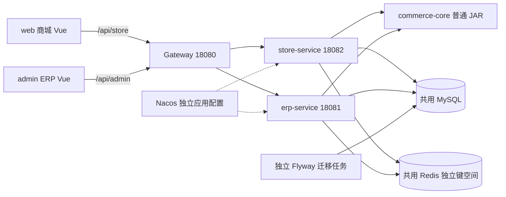

# B2C 电商平台阶段交接文档

> 后续更新：用户已要求校验并提交当前阶段成果到 `codex-STORY-newBranch`。本页保留限时暂停时的历史记录；最新提交范围、验证结果和保留文件以 `GIT_DELIVERY.md` 为准，历史“未提交”不再表示最新Git状态。

> 基于实际代码和测试结果编写，2026-11-25（北京时间）。本文件记录现状，不代表整个计划完成。
>
> 用户追加限时要求：连续执行2小时仍未完成时暂停，交付包括目录结构、说明及技术栈的完整Markdown。本次从目标创建时间19:54:49计时，收尾上限为21:54:49。最终暂停状态与最后验证时间在文末补充。

## 1. 结论与范围

目前具备可运行的商城浏览、商城账号/手机号/邮箱注册登录、个人资料、改密退出、收货地址，以及ERP商品/分类/品牌/SKU库存、会员启停、后台人员、角色和菜单权限管理。两个前端、两个业务服务、网关及隔离依赖已在本地启动。

**购物车、订单、评价、真实销售统计、内容管理尚未实现。** 当前商城商品详情没有伪造的购物车/支付按钮。原有后台工作台不是计划中的订单销售报表。不能验收完整的“下单→发货→收货→评价→报表”链路。

模块1和模块2已有较多验证证据，但尚未满足全部规范与完整模块验收要求，因此本次没有创建模块commit，也没有push。全部改动保留在工作区，不以空提交或大范围未验证提交代替用户要求。

逐项对照表见同目录 `PLAN_AUDIT.md`；会员认证详细操作见 `MEMBER_AUTH_VERIFICATION.md`。

## 2. 当前架构



- 两业务应用没有相互 Maven 依赖或跨服务HTTP调用；共享JAR在各自进程内执行，业务使用本地事务。
- `sys_user`只作为ERP后台身份；`member_user`是商城会员，不从后台复制账号。
- 两端各自Controller、应用Service、DTO/VO、认证配置；ERP目前保留原Java包名 `com.ecommerce.system` 和启动类 `SystemApplication`，Maven应用名已改为 `erp-service`。
- 明确组件扫描 `com.ecommerce.system` 或 `com.ecommerce.store`，外加共享领域和通用包，避免扫描另一应用Controller。
- 共享包当前仍有ERP专用商品输入DTO，类别/库存Controller仍有部分编排，需在架构收尾中清理，不能宣称分层规范已经全通过。
- 媒体目录由 `MEDIA_PATH` 指定，统一经 `/api/media/**` 只读访问；上传需要ERP会话。商城评价上传随模块4实现。
- Gateway保留 `/api/auth/**`、`/api/product/**` 等旧后台兼容路由，仍执行ERP鉴权；旧公开后台注册被禁止。

## 3. 技术栈及实际版本

| 领域 | 当前使用 | 说明 |
|---|---|---|
| Java | Java 21 | 本机微软JDK21，Maven编译目标21 |
| 应用框架 | Spring Boot 3.3.5 | ERP、Store、Gateway分别构建 |
| Spring Cloud | 2023.0.3 | Gateway路由 |
| Spring Cloud Alibaba | 2023.0.1.2 | Nacos配置/发现 |
| 持久层 | MyBatis-Plus 3.5.9 | 分页插件、Mapper、条件更新 |
| 数据库 | MySQL 8.0 | DECIMAL金额、本地事务、地址唯一约束 |
| 缓存/会话 | Redis 7 Alpine | 独立ERP/商城会话和限流/验证码 |
| 配置中心 | Nacos 2.3.0 | 本地Docker单机实例 |
| 迁移 | Flyway 10.20.1 | 独立容器任务，应用不自行迁移 |
| 文档 | Springdoc 2.6.0、Knife4j UI 4.4.0 | 两应用自动OpenAPI |
| 认证 | JWT、BCrypt | 独立密钥/受众，数据库会话版本 |
| 前端 | Vue 3.5、TypeScript 5.9 | 两套独立Vue应用 |
| UI | Element Plus 2.14、Tailwind 4.3 | 留白、简约界面，响应式布局 |
| 状态/路由 | Pinia 3、Vue Router 4 | 商城独立会员状态；后台权限路由 |
| 构建 | Vite 7.3、vue-tsc | npm锁文件固定实际依赖；Node要求22+ |
| HTTP | Axios | Result解包、Token注入和失败反馈 |
| 后端测试 | JUnit 5、Mockito、Surefire 3.5.3 | 真实执行数量非零 |
| 浏览器验收 | Playwright 1.65 + 本机Chrome | `channel: chrome`，真实服务，非Mock |
| 邮件 | 商城Java HttpClient调用Resend；本地capture | 默认不发送真实邮件 |
| 验证辅助 | Python 3、PyMySQL、bcrypt | 隔离MySQL事务、并发与迁移验证 |

ECharts尚未接入，因为模块5还未实现。原ERP Resend SDK依赖仍写为 `LATEST`，版本固定及静态规范检查待收尾。不得把现状描述为已完成阿里巴巴全量代码规范认证。

## 4. 实际目录结构

```text
E-commerce-Platform/
├─ admin/                              ERP前端（已有框架扩展）
│  ├─ src/
│  │  ├─ api/                          auth/product/category/menu/member/rbac API
│  │  ├─ components/                   CategoryManager、SkuManager、ProductImages
│  │  ├─ layouts/                      后台框架、侧栏和导航
│  │  ├─ router/                       固定路由、登录/权限守卫
│  │  ├─ stores/modules/               user、permission、app状态
│  │  ├─ views/
│  │  │  ├─ login/                     ERP独立登录
│  │  │  ├─ dashboard/                 原基础工作台（非新销售报表）
│  │  │  ├─ product/                   商品、category、brand页面
│  │  │  ├─ member/                    商城会员查询和启停
│  │  │  ├─ system/staff/              后台人员增删改、角色和密码设置
│  │  │  ├─ system/role/               角色及菜单/按钮授权
│  │  │  ├─ system/menu/               菜单树及按钮维护
│  │  │  └─ error/                     403/404页面
│  │  ├─ utils/                        HTTP、Token、类别等工具
│  │  └─ styles/                       样式
│  └─ package.json / package-lock.json / vite.config.ts
├─ web/                                独立商城前端（本任务新增）
│  ├─ src/
│  │  ├─ api/                          catalog、member、address、http
│  │  ├─ components/AddressBook.vue     地址管理弹窗和卡片
│  │  ├─ stores/member.ts              商城独立Pinia会话恢复/退出
│  │  ├─ views/                        Catalog、Product、Auth、Account、NotFound
│  │  ├─ App.vue                       商城页头、搜索、登录注册入口
│  │  ├─ router.ts                     公开页面及个人中心保护路由
│  │  ├─ main.ts                       Element Plus显式组件注册
│  │  └─ style.css                     商城响应式视觉
│  ├─ tests/                           catalog/member/address/member-management/rbac
│  └─ playwright.config.ts             本机Chrome自动验收
└─ server/
   ├─ pom.xml                          Maven聚合及依赖、Surefire配置
   ├─ gateway/                         /api前缀分流、兼容旧接口
   ├─ common/
   │  ├─ common-core/                  Result、异常等通用能力
   │  ├─ common-security/              JWT工具，校验密钥和受众
   │  ├─ common-redis/                 Redis基础配置
   │  └─ common-api/                   原公共API模块
   ├─ modules/
   │  ├─ system/system-api/            保留ERP原契约和VO
   │  ├─ erp/erp-service/              独立ERP应用
   │  │  └─ src/main/java/com/ecommerce/system/
   │  │     ├─ config/                 ERP鉴权、异常、审计填充
   │  │     ├─ controller/             商品、分类、品牌、库存、会员、RBAC
   │  │     ├─ domain/                 SysUser、Role、Menu、MemberAccount读模型
   │  │     ├─ dto/vo/                 后台输入及安全输出
   │  │     ├─ mapper/                 ERP账户/角色/菜单/会员持久层
   │  │     └─ service/                ERP应用编排，商品媒体、RBAC等
   │  ├─ store/store-service/          独立商城应用
   │  │  └─ src/main/java/com/ecommerce/store/
   │  │     ├─ config/                 Store分页、异常、会员鉴权
   │  │     ├─ controller/             Catalog、MemberAuth、MemberAddress
   │  │     ├─ entity/mapper/          MemberUser、MemberAddress及Mapper
   │  │     ├─ dto/vo/                 会员和地址安全输入/输出
   │  │     └─ service/                浏览、认证、地址、邮件验证码、限流
   │  └─ commerce/commerce-core/       共享普通JAR（没有启动类和HTTP接口）
   │     └─ src/main/java/com/ecommerce/commerce/
   │        ├─ entity/mapper/          商品、类别、品牌、SKU、图片、库存日志
   │        ├─ service/                商品规则、分类规则、库存、媒体
   │        ├─ dto/                    现商品输入DTO，边界待整理
   │        └─ config/                 媒体静态映射
   ├─ sql/
   │  ├─ migrations/V001__baseline.sql 空库基础表
   │  ├─ migrations/V002__catalog.sql  SKU、库存流水、媒体及旧商品默认SKU
   │  ├─ migrations/V003__members.sql  会员和地址
   │  ├─ migrations/V003_1__erp_permissions.sql 后台会话版本及菜单权限补充
   │  ├─ migrations/20261125_login_time.sql 原手工增量脚本，非Flyway版本名
   │  ├─ init.sql / product_module.sql 原初始化参考，禁止在已有库重跑
   │  └─ ecommerce-system.sql          用户原未跟踪文件，未改未暂存
   ├─ scripts/                        启动及真实接口/数据库验证脚本
   ├─ docs/                           核验、会员说明和本交接文档
   ├─ compose.b2c.yml                  当前双服务隔离栈（推荐本地验证入口）
   ├─ Dockerfile.service               通用业务服务镜像构建
   ├─ docker-compose.yml              原旧栈，仍需迁移路径收尾，不作为本次入口
   └─ .runtime/                       已忽略：本地私密配置、复制JAR、日志、截图、测试结果、邮件捕获
```

`system-service`原文件在Git中表现为删除，新增目录为 `erp-service`；在按模块提交前这些仍是工作区重构。测试目录分别在各服务 `src/test/java`。不要将 `target/`、`node_modules/`、`.runtime/`、Python缓存等生成文件提交。

## 5. 已实现业务及行为

### 5.1 商品与浏览

- 分类多级结构、排序和启停、引用检查及顺序操作下的防循环；品牌CRUD和引用限制。
- 商品基础编辑、推荐/上下架、规格售价库存状态；创建商品生成默认SKU。后续商品售价和库存由可用SKU汇总，基础编辑不能直接覆盖SKU汇总。
- 库存调整校验余量，写入操作人、原因、变化数量和余额流水；后台可查询历史。
- 图片实际JPEG/PNG解码、5MB/像素上限、重编码保存，持久媒体路径和画廊排序/替换/清空。
- 商城首页、商品列表、详情、规格选择、关键词/分类子树/品牌/价格筛选与分页排序；下架或全部SKU停用的商品不可公开查看。
- 待收尾：商品主图字段与画廊归属校验收敛，分类/品牌引用并发边界，完整CRUD与多图Chrome验收，代码规范与分层收敛。

### 5.2 商城会员与地址

- 账号、手机号、邮箱+密码登录；公开注册只创建会员，忽略伪造角色及状态。
- 手机号未验证，不宣称验证归属。邮箱注册使用一次性6位验证码，Redis保存HMAC摘要、10分钟TTL、60秒重发间隔、5次错误失效、邮箱/IP限流和Lua原子消费。
- BCrypt存储密码；独立JWT密钥/受众、Redis `store:session:`、浏览器 `store:token`。每次保护请求查会员状态和会话版本。
- 登录返回安全站内原页面，刷新恢复会话；修改昵称；退出撤销当前会话；改密撤销全部会话。
- 地址新增/读取/编辑/删除/默认设置。归属取登录会员而非请求memberId；其他会员访问返回404。首地址自动默认；删除默认地址时选择剩余地址补位。
- 同会员地址操作锁会员行，数据库生成列唯一索引保证至多一个默认地址；最多20个地址，已验证并发创建不会越过上限。

### 5.3 ERP会员、人员与权限

- 会员查询/分页/状态筛选和启停；状态变化递增商城会话版本，恢复账号不会使旧Token重新有效。
- 后台人员CRUD、角色设置、密码重置及启停；任何人员更新撤销其已有后台会话。
- 角色CRUD、菜单及按钮授权；角色停用不再参与权限查询；更改授权后服务端下一次请求立即使用新权限。
- 菜单树CRUD、防循环、站内路径验证、被角色引用或有子菜单时不能删除。
- 系统admin角色不可删除/停用/改编码；不能删除自己或停用自己；保留至少一个启用管理员；非管理员不能管理管理员账号。
- 后端资源权限如 `product:read/write`、`members:read/write`、`staff:read/write`、`roles:read/write`、`menu:read/write`。后台页面守卫、导航和主要编辑按钮同步控制。
- 剩余权限核验：全部按钮的完整矩阵、后台动态菜单状态与保留静态导航的一致性；角色管理页需要同时授予 `menu:read`，人员编辑需要 `roles:read`。

## 6. 数据迁移与数据库验证

| 文件 | 作用 | 当前证据 |
|---|---|---|
| V001 | 从空库建立原系统和商品基础表 | 隔离空库已初始化 |
| V002 | product_sku、inventory_log、media_file；旧商品默认SKU | 原商品88.25元/17件升级后保持原值，恰好一个默认SKU |
| V003 | member_user、member_address、唯一默认地址 | 真实CRUD、唯一性、并发地址验证通过 |
| V003.1 | sys_user.session_version、权限菜单及关联索引 | 本地隔离库执行成功，人员/角色/菜单真实接口通过 |

两应用均不执行Flyway。已执行SQL不能改校验和，因此权限补充使用V003.1；这偏离“每模块一个SQL”的理想文件数，但保留非破坏升级和可复验历史，后续不能合并重写已应用版本。

`scripts/verify_migrations.py`新建独立测试库，读取原脚本中的建表定义，核对10表结构后显式baseline，再执行Flyway；不在已有业务库执行原破坏性初始化，不删除数据库。原手工登录时间SQL不是Flyway命名，工具会报告忽略该文件；正式整理迁移目录时需将其移至明确的legacy目录并更新文档。

## 7. 本地运行和手动入口

| 服务 | 本机地址/端口 | 说明 |
|---|---|---|
| 商城 | http://127.0.0.1:5174/ | 页头登录注册，个人中心含地址 |
| ERP | http://127.0.0.1:5173/login | 商品、会员、人员、角色、菜单 |
| Gateway | http://127.0.0.1:18080 | 前端真实请求入口 |
| ERP后端 | 18081 | `/doc.html`、`/v3/api-docs` |
| Store后端 | 18082 | `/doc.html`、`/v3/api-docs` |
| MySQL | 13306 | `ecommerce_system`，隔离Docker卷 |
| Redis | 16379 | 隔离Docker容器 |
| Nacos | 18848，gRPC19848 | Docker单机 |

使用18080系列是为了避开本机8080等既有服务，不停止其他项目进程。计划默认8080/8081/8082仍是应用默认端口，验证启动器显式覆盖。

### 已配置的当前机器重启

在 `server/` 执行：

```powershell
docker compose --env-file .runtime/verify.env -f compose.b2c.yml -p ecommerce-b2c up -d mysql redis nacos
docker compose --env-file .runtime/verify.env -f compose.b2c.yml -p ecommerce-b2c run --rm migrate
mvn -B -pl modules/erp/erp-service,modules/store/store-service,gateway -am package -DskipTests
python scripts/start_local.py --restart
```

`start_local.py`验证目标Java进程和端口后重启，只运行复制到`.runtime`的JAR，避免Windows运行JAR锁定后无法重建。依赖尚未就绪时不要反复重启，先查对应日志。

分别在 `admin/`、`web/` 运行 `npm ci` 后执行 `npm run dev -- --host 127.0.0.1`。已有进程运行时不重复启动。后台本地配置使用 `VITE_USE_MOCK=false`、`VITE_API_BASE_URL=/api/admin`、`VITE_PROXY_TARGET=http://127.0.0.1:18080`；商城代理同一Gateway。前端配置不含密钥。

当前机器已有忽略文件 `.runtime/verify.env`，包含 `DB_PASSWORD`、不同的 `ERP_JWT_SECRET` 和 `STORE_JWT_SECRET`。本文件不展示密钥。全新机器需要自行配置强密钥及初始化后台管理员；当前生产级安全bootstrap脚本尚未交付，不能把仅用于本地验证的固定测试账号当作生产初始化方案。

本地验证ERP账号由 `verify_catalog.py`创建，账号 `catalog_admin`，密码 `CatalogTest123!`，仅用于隔离测试库。商城请自行注册，后台账号不自动成为会员。

### 邮件说明

默认 `STORE_MAIL_MODE=disabled`。本地验证启动器使用capture，验证码写入 `.runtime/mail`，不会投递真实邮箱。在 `server/` 运行 `python scripts/read_local_mail.py your-address@example.com` 获取该测试邮箱的验证码。生产使用Resend需要自行配置服务端密钥和已验证发件人，capture禁止在生产profile启用。未执行真实邮件测试。

## 8. 接口概览（已实现）

所有接口响应使用 `Result<T>`，分页 `pageNum/pageSize`，返回MyBatis分页记录结构。参数错误和业务冲突有统一业务码；不可仅凭HTTP200判断业务成功，应检查 `code`。

| 前缀 | 主要资源 |
|---|---|
| `/api/store/catalog` | categories、brands、products、products/{id} |
| `/api/store/auth` | capabilities、email-code、register、login、logout、me、password |
| `/api/store/addresses` | GET/POST列表新增，/{id}读取修改删除，/{id}/default设置默认 |
| `/api/admin/product` | list、options、/{id}、category、brand、/{id}/skus、库存/history、images |
| `/api/admin/upload/image` | ERP图片上传 |
| `/api/admin/members` | 会员列表，/{id}/status启停 |
| `/api/admin/staff` | 后台人员列表/新增，/{id}修改删除 |
| `/api/admin/roles` | 角色列表/新增，/{id}编辑授权和删除 |
| `/api/admin/menu` | /list菜单树，新增、/{id}修改删除 |
| `/api/admin/auth` | 原后台login、logout、userinfo、menus；register明确拒绝 |

新增订单等模块时按两端前缀扩展，不能让商城调用ERP业务接口。

## 9. 验证命令和证据

后端在 `server/`：

```powershell
mvn -B -pl modules/erp/erp-service,modules/store/store-service,gateway -am package "-Dtest=MemberAuthServiceTest,MemberMailSenderTest,MemberAddressServiceTest,RbacManagementTest,PasswordRegisterStrategyTest,CategoryManagementTest,CategoryApiTest,ProductManagementTest,AuthLoginHistoryTest,ServiceBoundaryTest" "-Dsurefire.failIfNoSpecifiedTests=false"
python scripts/reset_verify_limits.py
.runtime/venv/Scripts/python scripts/verify_catalog.py
.runtime/venv/Scripts/python scripts/verify_members.py
.runtime/venv/Scripts/python scripts/verify_addresses.py
.runtime/venv/Scripts/python scripts/verify_member_management.py
.runtime/venv/Scripts/python scripts/verify_rbac.py
.runtime/venv/Scripts/python scripts/verify_migrations.py
```

重复全部注册测试可能触发真实限流。测试前或手动验收前可运行 `reset_verify_limits.py`，它只接受Docker标签为 `ecommerce-b2c/redis` 的隔离容器，清理 `store:limit:*` 计数，不清理会话/验证码，也不降低生产限流规则。

分别在两个前端运行 `npm run build`（已包含vue-tsc类型检查）。在 `web/` 运行 `npx playwright test`，使用真实Chrome和真实Gateway，不使用Mock。

已取得证据：

- ERP 31项JUnit通过，包含原商品/分类/认证26项以及新增后台授权5项。
- Store 13项JUnit通过：认证7、邮件边界2、地址4。
- 商品真实接口：15次并发扣减中10次成功、5次库存不足；流水余额正确；品牌/分类引用、图像格式/替换/清空、可售状态及文档访问通过。
- 会员真实接口：账号/手机/邮箱注册登录、唯一性、哈希、跨端Token、退出、改密、禁用、验证码重放和错误次数通过。
- 地址真实MySQL：16次并发默认切换仍唯一；25次并发新增19成功6超容量（原有1条），总数20；跨会员4种操作拒绝、伪造memberId无效、数据库唯一约束通过。
- ERP会员真实接口：只读角色、停用角色不可授予写权限、禁用/恢复不复活商城旧Token通过。
- RBAC真实接口：人员/角色/菜单CRUD、授权即时变化、密码重置、禁用恢复、管理员保护、树循环/引用限制通过。
- Chrome分组：商品浏览3尺寸+ERP商品页面4项，认证4项，地址3项，ERP会员2项，角色人员1项均曾分别通过；最后整组回归结果见文末。
- 双前端生产构建通过。没有运行真实邮件测试。

证据在 `.runtime/`：`address-result.json`、`member-result.json`、`member-management-result.json`、`catalog-result.json`、`migration-result.json`、`rbac-result.json`、`browser-results.json`；对应日志 `address-build.log`、`rbac-build.log`，截图 `store-address-*.png`、`store-register-*.png`、`erp-staff.png`、`erp-members.png`、`erp-menu-permissions.png` 等。

这些局部证据不能替代完整模块提交门槛或最终订单验收。Playwright报告默认被下一次运行覆盖，正式交付需归档最终报告及必要截图。

## 10. 未完成项、原因与解决办法

| 优先级 | 项目 | 分类 | 继续实施办法 |
|---|---|---|---|
| P0 | 模块1最终收尾 | 计划内未完成 | 收敛主图和画廊校验、删除商品库存接口拒绝、分类/品牌并发引用检查；完成后台完整CRUD/多图Chrome流程；补规范检查 |
| P0 | 模块2权限全矩阵 | 计划内未完成 | 核验所有写按钮、静态导航与动态菜单启停一致性、角色选择权限依赖、密码/账号竞态；覆盖真实会话与越权矩阵 |
| P0 | 独立模块commit | 计划内未完成 | 逐模块验证后按文件/补丁拆分暂存，先提交隔离/商品，再会员权限，记录哈希，不push；不可混入用户原文件 |
| P1 | 购物车与订单 | 计划内未实现 | 新建cart/trade_order/item/log，SKU购物车，价格确认、幂等、原子库存扣减，本地事务/快照，取消与发货条件更新竞争，双端页面及MySQL并发测试 |
| P1 | 商品评价 | 计划内未实现 | 已完成订单明细唯一评价，会员及图片归属、最多9图、公开筛选脱敏、后台隐藏恢复审计 |
| P1 | 统计报表 | 计划内未实现 | ECharts、真实已完成订单快照金额/销量、近30天北京时间自然日聚合、会员增长、索引缓存与权限 |
| P1 | 内容管理 | 计划内未实现 | 轮播和公告CRUD、时间窗/排序、内部链接白名单、商城公开过滤及纯文本渲染 |
| P1 | 开发/部署规范 | 计划内未完成 | 更新旧docker-compose和README路径，补安全管理员bootstrap及静态规范门禁，固定LATEST依赖，整理共享DTO/Controller分层 |
| P1 | 最终全链路 | 计划内未完成 | 真实Chrome完成ERP建商品→会员邮箱注册/地址→SKU购物车下单→发货→收货晒单→统计，并单测取消恢复库存 |

## 11. 计划明确暂不实现

支付接口及支付记录、物流供应商接口、优惠券/拼团/秒杀、分销、积分、多租户/SaaS、短信验证码。它们不是遗漏缺陷。后续订单按已确认规则“下单即待发货”、人民币、零运费、北京时间；物流仅手工承运商/运单号，不能伪造支付或实收金额。

## 12. Git、保留文件与恢复工作

- 当前任务未产生commit，未push。最近原提交是 `92cf34a`。
- `server/gateway/src/main/resources/application-local.yml` 是用户原改动，持续保留、不暂存；`server/sql/ecommerce-system.sql` 是用户原未跟踪文件，持续保留、不暂存。
- `.runtime/`与私密本地环境文件不进入Git；新增Python缓存需忽略。
- 停止开发不等同于回滚或删除实现。暂停后以当前工作区和本文件为准恢复，不重新覆盖已有代码、不重新执行破坏性SQL初始化。
- 继续前先核对 `git status`、服务端口归属、Flyway历史和最后验收报告，然后处理上表P0问题。未完成的六模块目标保持未完成状态。

## 13. 最终收尾记录

收尾时间：2026-11-25 21:56:18（北京时间）。按用户两小时时限暂停开发，目标仍未完成。本地服务保留运行供手动核验。

- 最终真实Chrome回归14/14通过（1.1分钟）：商品/ERP浏览4项、会员认证4项、地址3项、会员管理2项、人员角色菜单1项；已列页面覆盖1440/1200/390px，不代表全部页面完整验收。
- 最新V003.1迁移回归通过：空库初始化/重复迁移/校验，旧库V001结构核对/基线/升级，原商品价格88.25和库存17保留，默认SKU唯一，原后台账号保留且不复制为会员。
- 迁移验证首次失败源于脚本误将旧库与升级后已增加索引的结构比较；已修复为先对照V001再升级，真实MySQL复验通过。
- 登录、注册、ERP登录、Gateway商品列表最后HTTP检查均200。后端已通过ERP31项及商城13项测试，双前端生产构建已通过。收尾仅修改验证脚本和文档。
- 已跟踪修改git diff --check通过，仅有行尾提示；阿里巴巴静态规则门禁尚未完成。
- 最终浏览器报告已归档server/.runtime/final-browser-results.json；迁移证据server/.runtime/migration-result.json。已清理隔离环境限流计数，保留会话及本地测试邮件。
- 历史验证可能保留测试会员/角色及隔离数据库；未删除用户数据或数据卷。
- 模块1/2尚需收尾、模块3–6未实现；原因及处理办法见交接文档第10节。无本任务commit、无push，原网关配置和SQL保留。
